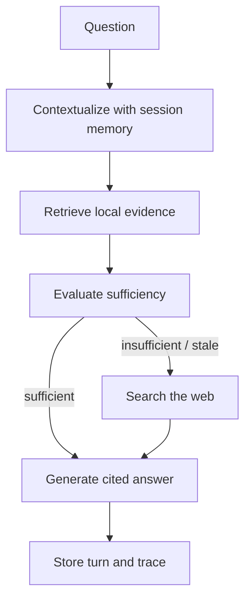

# GameScope Agent

> **Status: Work in Progress / portfolio refactor**  
> The core evidence-first workflow, persistent retrieval, web fallback, session
> memory, tests, and CLI are implemented. A small UI and broader evaluation set
> remain on the roadmap.

GameScope is a stateful retrieval-augmented research agent for video-game
questions. It searches a local Chroma collection first, evaluates whether the
retrieved evidence is actually sufficient, and uses web search only when the
local corpus is incomplete, uncertain, or stale.

## Why this project is useful

Many RAG demonstrations treat a semantically similar document as sufficient
evidence. GameScope separates **retrieval** from **evidence sufficiency** and
validates the required control flow:

```text
Local retrieval -> Evaluation -> Final answer
```

or, only when required:

```text
Local retrieval -> Evaluation -> Web search -> Final answer
```

## Highlights

- Persistent local retrieval with ChromaDB and OpenAI embeddings
- Pydantic-validated game records and structured evaluation output
- Controlled Tavily fallback for missing or time-sensitive information
- Cited answers with an inspectable execution trace
- Session memory for contextual follow-up questions
- Idempotent corpus ingestion
- Dependency-injected workflow with API-free unit tests
- Ruff, Pytest, and GitHub Actions

## Architecture



See [`docs/architecture.md`](docs/architecture.md) for the design rationale.

## Quick start

```bash
python -m venv .venv
source .venv/bin/activate
python -m pip install --upgrade pip
python -m pip install -e ".[dev]"

cp .env.example .env
# Add OPENAI_API_KEY and, for web fallback, TAVILY_API_KEY to .env
# Keep OPENAI_BASE_URL absent unless you intentionally use a custom endpoint.

gamescope ingest
gamescope ask "When was Pokémon Gold and Silver released?"
gamescope demo
```

The first ingestion call creates the local `.chroma/` directory. It is ignored
by Git and can be rebuilt from `data/games/`.

## Test and quality checks

```bash
python -m ruff check .
python -m pytest
```

The unit tests use fake retrieval, evaluation, search, and generation services,
so they do not consume API credits.

## Troubleshooting

If ingestion fails with `Request URL is missing an 'http://' or 'https://'`
or `openai.APIConnectionError`, inspect the optional base URL:

```bash
grep '^OPENAI_BASE_URL' .env 2>/dev/null || true
printf 'shell value: <%s>\n' "${OPENAI_BASE_URL-UNSET}"
```

For the standard OpenAI API, remove the variable instead of leaving it empty:

```bash
sed -i '/^OPENAI_BASE_URL[[:space:]]*=/d' .env
unset OPENAI_BASE_URL
gamescope ingest
```

A custom endpoint must be a complete URL such as
`http://localhost:11434/v1`.

## Repository structure

```text
src/gamescope_agent/   application code
data/games/             demonstration corpus
examples/               minimal Python example
tests/                  deterministic unit tests
docs/                   architecture and migration notes
.github/workflows/      CI checks
```

## Limitations

- Session memory is process-local and not intended for multi-user deployment.
- The demonstration corpus is deliberately small.
- Evidence evaluation and final synthesis still depend on model quality.
- Web snippets should not be treated as a substitute for full source review in
  high-stakes research.
- The CLI is the only user interface in the current WIP release.

## Roadmap

- Add an evaluation dataset for routing accuracy and citation correctness
- Persist sessions in SQLite or PostgreSQL
- Add a small FastAPI or Streamlit interface
- Add provider adapters for local models and alternative embedding backends
- Add cost and latency metrics to traces

## Project origin

This project began as an educational assignment and was subsequently
restructured as an independent portfolio repository. The original course
framework and assignment instructions are intentionally excluded. See
[`NOTICE.md`](NOTICE.md) and [`docs/migration-notes.md`](docs/migration-notes.md).

## License

The standalone application code is released under the MIT License. Game and
platform names are trademarks of their respective owners; see `NOTICE.md`.
