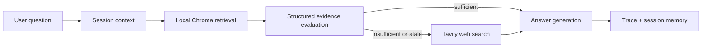

# Architecture

## Design decisions

The workflow is explicitly orchestrated rather than allowing the model to skip
or reorder evidence-control steps. Every question must pass through local
retrieval and structured evaluation. Web search is permitted only when local
evidence is insufficient, uncertain, or stale.

This makes the workflow deterministic at the control-flow level while still
using language models for evidence assessment and answer synthesis.
