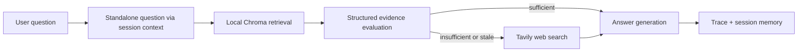

# Architecture

## Design decisions

The workflow is explicitly orchestrated rather than allowing the model to skip
or reorder evidence-control steps. Every question must pass through local
retrieval and structured evaluation. Web search is permitted only when local
evidence is insufficient, uncertain, or stale.

This makes the workflow deterministic at the control-flow level while still
using language models for evidence assessment and answer synthesis.

## Follow-up questions

Follow-ups such as "And on which platform?" cannot be retrieved or judged on
their own. When session history exists, a rewriter turns the latest message
into a standalone question that is then used for retrieval, evaluation and
answer generation. The raw chat history, including long earlier answers, never
reaches the embedding search. The first question of a session is passed on
unchanged without an extra model call.

If no rewriter is configured, `SessionMemory` falls back to a keyword heuristic
that prepends recent turns to the question.

## Workflow validation

Each service call is recorded in `AgentRun.tool_calls` at the moment it
happens. `validate_workflow` compares that record with the sequence required by
the evidence policy, so a regression in the control flow raises an error
instead of passing silently.
